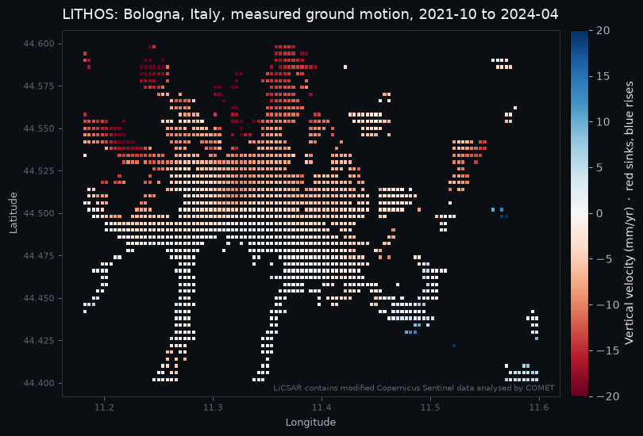

<a href="https://northflow.no"></a>

# LITHOS

LITHOS is an open source ground motion map that shows how the ground rises and sinks, to the millimetre, measured by radar satellites.

[Research page](https://research.northflow.no/systems/lithos) · [Quickstart](docs/quickstart.md) · [Notebook](https://colab.research.google.com/github/northflowlabs/lithos/blob/main/packages/notebook/lithos_quickstart.ipynb) · [Licence](#licence)

[](https://github.com/northflowlabs/lithos/actions/workflows/ci.yml)
[](LICENSE)



<sub>Bologna, measured from Sentinel-1, October 2021 to April 2024: more than 20 mm per year of subsidence on the plain north of the city. Red is sinking, blue is rising. LiCSAR contains modified Copernicus Sentinel data analysed by COMET.</sub>

## What it does

Cities sink as groundwater is drawn down, coastlines subside, and dams, railways and buildings deform years before anyone notices. Radar satellites have measured this to the millimetre for more than a decade, and the processed data is public.

LITHOS reads two of those public datasets. From the global COMET LiCSAR archive it reads unwrapped interferograms and solves them into scenes: displacement histories in two viewing geometries, combined into vertical motion. With a free key it also reads Ortho tiles from the European Ground Motion Service (EGMS). A map a non-specialist can read and an anomaly engine sit on top. LITHOS does not process raw radar.

- **Click a point** to see its line-of-sight and vertical velocity in mm per year, its displacement time series and a plain-language summary, for example: *"This point has been sinking about 14 mm/year and accelerated after early 2023."*
- **Draw an area** to get aggregate statistics, a count of anomalous points and callouts for any new subsidence or uplift bowl inside it.
- **See where data exists.** A coverage layer shows where the archive holds Sentinel-1 frames and how recent they are.
- **Share and export.** Every view has a permalink. Export the map as PNG, a time series as CSV or an area as GeoJSON.
- **Build on it.** A documented API serves coverage, points, time series and anomaly results.

LITHOS measures dry-land surface motion: subsidence and uplift. It reports observed movement and flags anomalies. It does not predict structural failure, and it does not cover water, seabeds or offshore areas.

## The anomaly engine

Every point and area runs through a pipeline of standard, published statistics:

- **Acceleration and change points:** finds when a trend shifts, with the onset date
- **Emerging clusters:** hotspot analysis that flags a new deformation bowl inside an area
- **Seasonal and secular motion:** separates reversible seasonal swings from long-term motion
- **Confidence gating:** low-coherence points are not over-flagged

Each flag carries a machine-readable record (type, magnitude, onset, confidence, evidence) and one sentence that states its uncertainty. A regression suite scores the engine on labelled test series with a known answer, and a recorded real series keeps the time-series solver honest. See [docs/anomaly-engine.md](docs/anomaly-engine.md).

## Coverage

| Region | Source | Coverage | Notes |
| --- | --- | --- | --- |
| Bologna, Italy | COMET LiCSAR | Measured scene, about 1,500 points at 400 m | October 2021 to April 2024 |
| Anywhere the archive has an ascending and a descending frame | COMET LiCSAR | Build a scene with one command | Frames are mapped in the coverage layer |
| EU, Norway, UK, Iceland | Copernicus EGMS | Dense, validated, millimetre grade | Needs a free CLMS API key; rolling five-year releases |

See [docs/coverage.md](docs/coverage.md).

## Run it locally

LITHOS runs with one command and needs no account. EGMS tiles need a free [CLMS API key](https://land.copernicus.eu); the measured scenes do not.

```bash
git clone https://github.com/northflowlabs/lithos.git
cd lithos
cp .env.example .env        # optional: add a CLMS API key for EGMS
docker compose -f infra/docker-compose.yml up --build
```

Open `http://localhost:3000` for the web app and `http://localhost:8000/docs` for the API. For the notebook and a Python quickstart, see [docs/quickstart.md](docs/quickstart.md).

## How it works

```
                 +--------------------------------------------+
   EGMS  ----->  |  ingest: pluggable source adapters          |
 LiCSAR  ----->  |  normalise to one canonical schema          |
                 +-------------------+------------------------+
                                     v
                 +--------------------------------------------+
                 |  core: anomaly engine (standard stats)      |
                 |  spatial index + precomputed flags          |
                 +-------------------+------------------------+
                                     v
            +---------------+--------+--------+---------------+
            v               v                 v               v
       web (map)      public API         notebook        exports
```

Every source normalises into one schema, so new coverage changes nothing downstream. Design notes are in [docs/architecture.md](docs/architecture.md).

## Data and attribution

Credit these sources in any work you publish with LITHOS:

- **COMET LiCSAR.** LiCSAR contains modified Copernicus Sentinel data [years used] analysed by the Centre for the Observation and Modelling of Earthquakes, Volcanoes and Tectonics (COMET). UK Open Government Licence v3.0.
- **European Ground Motion Service (EGMS)**, Copernicus Land Monitoring Service, when you use EGMS tiles. Contains modified Copernicus data.

LITHOS fetches LiCSAR products over the network and contains no LiCSAR or LiCSBAS code. Its time-series solver is written from the published small-baseline method. The citation text and the details are in [docs/attribution.md](docs/attribution.md) and [docs/licensing.md](docs/licensing.md).

## Cite LITHOS

```
Northflow Technologies AS (2026). LITHOS: open ground motion intelligence.
https://github.com/northflowlabs/lithos
```

Used LITHOS in a story or a study? Open an issue with the `showcase` label or write to hello@northflow.no.

## Roadmap

Available now: measured scenes from LiCSAR, EGMS tiles with a key, point inspection, area scans, the anomaly engine, the coverage layer, permalinks, exports, the API, the web app and the notebook.

Planned: more scenes, validation against EGMS and GNSS, more export formats, and a processing path that derives products directly from raw Sentinel-1 data.

Out of scope: predicting structural or geological failure, and water, seabed and offshore analysis.

## Contributing

We welcome new coverage adapters, anomaly methods, translations, documentation and bug reports. Start with [CONTRIBUTING.md](CONTRIBUTING.md) and the [good first issues](https://github.com/northflowlabs/lithos/labels/good%20first%20issue). A clear, reproducible issue is the fastest way to get something fixed.

## Licence

LITHOS is licensed under the [Apache License 2.0](LICENSE).

Copyright 2026 Northflow Technologies AS
